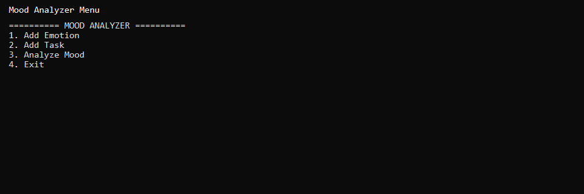
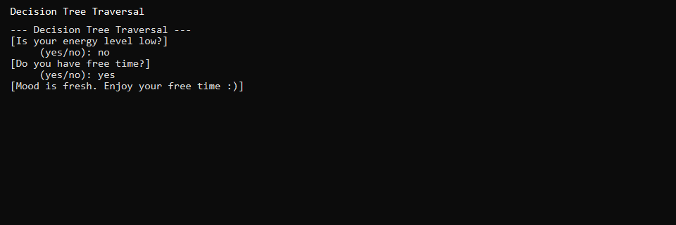
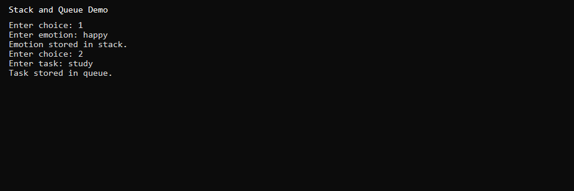

# Mood Analyzer (C++)

Interactive console application that combines a **decision tree**, **stack**, and **queue** to demonstrate core data structures while providing a simple mood-analysis experience.

## Features

- Menu-driven CLI for adding emotions (stack) and tasks (queue)
- Decision tree traversal with yes/no questions
- Visual path output showing tree navigation
- Mood recommendations based on energy, pressure, and free time

## Tech Stack

- C++17
- STL: `stack`, `queue`, `string`
- Manual linked tree nodes
- Visual Studio 2022 (v143 toolset, x64)

## Screenshots







## Build and Run

1. Open `ConsoleApplication2.sln` in Visual Studio 2022
2. Set configuration to **Debug | x64**
3. Build and run (F5)

```powershell
# From Developer Command Prompt after building:
ConsoleApplication2\x64\Debug\ConsoleApplication2.exe
```

## Project Structure

```
ConsoleApplication2/
├── ConsoleApplication2/
│   └── ConsoleApplication2.cpp   # Main source
└── ConsoleApplication2.sln
```

## Notes

- Stack and queue inputs are collected for DSA demonstration; mood analysis uses the decision tree only.
- Sample menu flow: add an emotion, add a task, then choose **Analyze Mood**.

## Author

Muhammad Afzal Kalwar — [GitHub](https://github.com/mafzalkalwardev)

## License

MIT — see [LICENSE](LICENSE).
